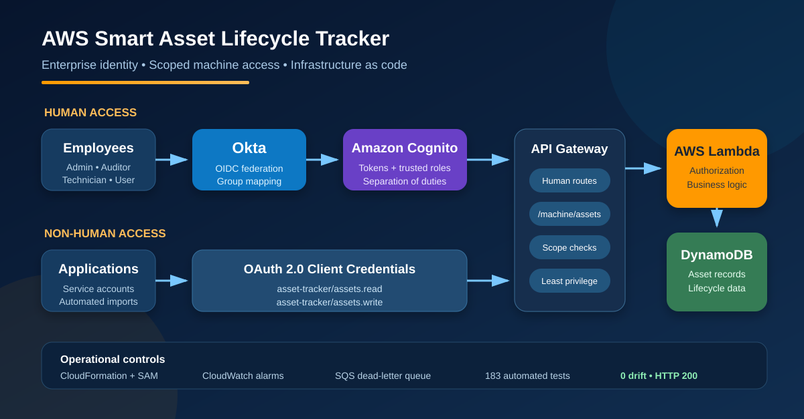

# AWS Smart Asset Lifecycle Tracker

A secure serverless asset-management application built with Okta federation, Amazon Cognito, API Gateway, Lambda, DynamoDB, S3, Amazon Bedrock, EventBridge, SQS, SNS, and CloudWatch. It supports role-based human access and OAuth 2.0 client-credentials access for non-human workloads. SailPoint remains planned as the identity-governance and lifecycle-provisioning layer.

## Current milestone

The four-week project and final application demonstration are complete.

- **Week 1:** Serverless infrastructure, Cognito authentication, asset APIs, and role-based authorization.
- **Week 2:** Private S3 photo storage, authorized photo access, and Amazon Bedrock photo analysis.
- **Week 3:** Maintenance history, deterministic depreciation, AI-assisted recommendations, and scheduled notifications.
- **Week 4:** Security testing, CloudWatch monitoring, deployment verification, and final project documentation.
- **Enterprise identity extension:** Okta OIDC federation, trusted group-to-role mapping, separation-of-duties enforcement, and OAuth 2.0 machine identities with scoped API access.

**Live application:** https://main.dx980x98nt3d5.amplifyapp.com/

The application requires an authorized account. Access depends on the user's assigned role and asset scope.

Okta enterprise federation is implemented. SailPoint remains a future extension for identity governance, lifecycle provisioning, access requests, certifications, and enterprise separation-of-duties policy management.

## Architecture

See [`docs/architecture.md`](docs/architecture.md), [`docs/data-model.md`](docs/data-model.md), [`docs/role-permissions.md`](docs/role-permissions.md).

## Architecture diagrams



See [`docs/architecture/README.md`](docs/architecture/README.md) for the complete four-week target architecture and the weekly architecture progression diagrams.

## Enterprise identity and machine access

- Okta federates to Amazon Cognito through OpenID Connect.
- A Cognito pre-token generation Lambda maps approved Okta groups into trusted application roles.
- Conflicting Administrator and Auditor assignments are rejected to enforce separation of duties.
- Native Cognito authentication remains available alongside Okta sign-in.
- OAuth 2.0 client credentials provide non-human access without using employee accounts.
- `asset-tracker/assets.read` and `asset-tracker/assets.write` scopes enforce least privilege.
- Dedicated `/machine/assets` routes separate machine operations from human-only workflows.
- API Gateway validates OAuth scopes, and Lambda applies an additional route and scope allowlist.
- Machine identities cannot access maintenance routes.
- Application and monitoring resources are managed by separate drift-free CloudFormation stacks.

## Prerequisites

- AWS CLI configured for a non-production AWS account
- AWS SAM CLI
- Python 3.11 (matches the Lambda `Runtime` in `infrastructure/template.yaml`; required for a native `sam build` — use `sam build --use-container` instead if you don't have 3.11 installed locally)
- Node.js 20 or later

## Quick start with `scripts/dev.sh`

`scripts/dev.sh` wraps the manual steps below into single commands for a non-production test stack. It requires the AWS CLI configured for your account, the SAM CLI, `python3`, and `npm`.

```bash
scripts/dev.sh up                                                                 # test, build, deploy, write frontend/.env, seed sample data
scripts/dev.sh user -e you@example.com -g Administrator -d IT                     # create a confirmed login; password is prompted securely
scripts/dev.sh web                                                                # start the frontend
```

| Command                                              | What it does                                                                                                                                                                                                                                                                       |
| ---------------------------------------------------- | ---------------------------------------------------------------------------------------------------------------------------------------------------------------------------------------------------------------------------------------------------------------------------------- |
| `up`                                                 | Runs unit tests, validates and builds (cached), deploys without prompts, writes `frontend/.env`, and seeds `sample-data/assets.json`                                                                                                                                               |
| `deploy`                                             | Build and deploy only, then refresh `frontend/.env`                                                                                                                                                                                                                                |
| `sync`                                               | Watches backend code and hot-syncs Lambda changes with `sam sync --watch` (dev stacks only)                                                                                                                                                                                        |
| `env`                                                | Writes `frontend/.env` from the stack outputs                                                                                                                                                                                                                                      |
| `seed`                                               | Loads the sample assets through the deployed Lambda, so validation and tag uniqueness still apply. Safe to re-run; existing tags are skipped                                                                                                                                       |
| `user -e EMAIL -g GROUP [-d DEPARTMENT] [-p PASSWORD]` | Creates a confirmed Cognito user in `GROUP`, optionally setting `custom:department`. The password must meet the pool policy (12+ characters with upper, lower, number, and symbol); you're prompted for it at a hidden prompt unless `-p` is given. Long forms: `--email`, `--password`, `--group`, `--department` |
| `web`                                                | Installs frontend dependencies if needed and runs the Vite dev server                                                                                                                                                                                                              |
| `smoke [--image PHOTO] [--keep]`                     | Smoke-tests the deployed stack by invoking each Lambda with synthetic Cognito claims, checks the logs for authorization errors, and writes `smoke-test-results.md`. Removes its test data unless `--keep` is given |
| `down [--purge]`                                     | Deletes the stack; `--purge` also deletes the retained DynamoDB table                                                                                                                                                                                                              |
| `test` / `build`                                     | Runs only the unit tests / only validate and build                                                                                                                                                                                                                                 |

Defaults can be overridden with environment variables: `ENVIRONMENT` (`dev` or `test`, default `dev`), `STACK_NAME` (default `smart-asset-tracker-$ENVIRONMENT`), and `AWS_REGION` (default `us-east-1`).

Wrap the password in single quotes so characters like `!` and `$` aren't interpreted by the shell. A password passed with `-p` is saved in your shell history; leave out `-p` to type it at a hidden prompt instead.

To test without touching the shared `dev` stack, use a different environment. Resource names are derived from `ENVIRONMENT`, so this creates a fully separate stack, table, functions, and user pool. Changing only `STACK_NAME` is not enough, because the table and function names would collide.

```bash
ENVIRONMENT=test scripts/dev.sh up
ENVIRONMENT=test scripts/dev.sh down --purge
```

## Test and deploy the backend manually

```bash
python3 -m unittest discover -s backend/tests -v
sam validate --template-file infrastructure/template.yaml
sam build --template-file infrastructure/template.yaml
sam deploy --guided
```

Use stack name `smart-asset-tracker-dev` and a development AWS region. After deployment, run `scripts/dev.sh env` (or copy the stack outputs into `frontend/.env` using `frontend/.env.example`).

### Tear down after testing

The stack has billable resources (DynamoDB, API Gateway, Cognito). Once you're done testing, delete it rather than leaving it running:

```bash
sam delete --stack-name smart-asset-tracker-dev
```

`AssetTable` and the photo S3 bucket have `DeletionPolicy: Retain`. The helper's
`down --purge` deletes the retained table after deleting the stack; the retained
photo bucket and its contents must be removed separately if no longer needed.

## Run the frontend

```bash
cd frontend
cp .env.example .env
npm install
npm run dev
```

## Create test users

Create users in Cognito, confirm them, and assign them to one of these groups:

- `Employee`
- `Technician`
- `Manager`
- `Administrator`
- `Auditor`

`scripts/dev.sh user -e EMAIL -g GROUP [-d DEPARTMENT]` does this in one step and prompts for the password.

For employee record scoping, set each asset's `assignedUserId` to the user's Cognito `sub`. For manager scoping, add a mutable Cognito custom attribute named `custom:department` and populate it before the user signs in.

## Security notes

- API permissions are enforced in Lambda as well as API Gateway.
- Employee and Manager access is restricted at record level.
- Technician updates are restricted to operational fields.
- Financial values are validated with `Decimal`, never floating point.
- Secrets and tokens must not be committed.
- The current scan-based search and scheduled evaluation are appropriate only for the small demonstration dataset; production access patterns should use indexes and partitioned or event-driven processing.

## Week 2: Secure Photo Intelligence

Week 2 expands the Smart Asset Lifecycle Tracker with secure asset-photo storage, Amazon Bedrock image analysis, and an authorized photo gallery.

### Features completed

- Private Amazon S3 bucket for asset photographs
- S3 Block Public Access and server-side encryption
- Five-minute presigned upload forms
- JPEG and PNG validation with a 3.75 MB limit
- Cognito role and department authorization
- User-specific upload paths under `pending/{user-id}/`
- S3-triggered asynchronous photo-analysis Lambda
- Amazon Bedrock Nova Lite multimodal analysis
- Structured and validated Bedrock JSON responses
- Suggested asset category, model, description, condition, useful life, estimated production date, maintenance category, and estimated value
- Manual approval before applying Bedrock suggestions
- Secure photo gallery with short-lived image-access URLs
- Backend authorization before every photo URL is generated
- DynamoDB transactions for unique asset tags
- CloudWatch logging and AWS X-Ray tracing
- Realistic equipment photographs replacing placeholder records

### Photo security

Asset photographs are never publicly accessible.

The backend generates a temporary image URL only after:

1. API Gateway validates the Cognito token.
2. Lambda reads the user identity and groups from verified Cognito claims.
3. Lambda loads the asset record from DynamoDB.
4. Lambda verifies the user’s role and access to that specific asset.
5. Amazon S3 generates a short-lived presigned URL.

Role, department, assignment, and ownership values supplied by the browser are not trusted.

### Role-based photograph access

- **Administrator:** access to all authorized asset photographs
- **Auditor:** read-only access according to the application policy
- **Manager:** photographs for assets in the manager’s department
- **Technician:** photographs within the technician’s authorized scope
- **Employee:** photographs for assets assigned to that employee
- **Unauthenticated or unauthorized user:** receives a `401` or `403` response

### Validation

```bash
python3 -m py_compile \
  backend/asset_api/app.py \
  backend/asset_api/domain.py \
  backend/asset_api/photo_analysis.py

python3 -m unittest discover -s backend/tests -v

sam validate --template-file infrastructure/template.yaml
sam build --template-file infrastructure/template.yaml

cd frontend
npm ci
npm run build
```

## Week 3: Maintenance Intelligence

Week 3 extends the application from asset registration and secure photo
analysis into maintenance history, lifecycle calculations, scheduled alerts,
and AI-assisted recommendations. Deterministic application rules remain the
source of truth for dates, status, priority, and financial calculations;
Amazon Bedrock adds contextual guidance without replacing those controls.

### Features completed

- Maintenance records stored under each asset using the
  `MAINTENANCE#<date>#<id>` DynamoDB sort-key pattern
- Create, list, update, and delete maintenance operations with backend
  validation and authorization
- Authenticated Cognito identity recorded server-side as `performedBy` and
  `performedByEmail`
- Record-scope enforcement for Administrator, Manager, Technician, Auditor,
  and Employee roles
- Optimistic concurrency checks that return `409` for stale maintenance
  updates
- Atomic record movement when an edited maintenance date changes its sort key
- Deterministic maintenance status, priority, recommended service date, and
  cleaning date calculations
- Condition-aware service intervals and maintenance-history-aware
  recommendations
- Straight-line depreciation using completed monthly anniversaries, useful
  life, purchase value, and salvage value
- Amazon Bedrock maintenance guidance returned as validated structured JSON
- Human review of AI-generated guidance before operational action
- EventBridge-driven maintenance evaluation and consolidated Amazon SNS alerts
  for assets that are due soon or overdue
- Error isolation so one malformed asset does not stop the scheduled evaluation

### Security and AI boundaries

- API Gateway validates the Cognito token before protected maintenance routes
  are invoked.
- Lambda authorizes access to the target asset before returning its maintenance
  history or generating a recommendation.
- Browser-supplied identity fields are ignored; performer identity comes from
  verified Cognito claims.
- Read-only roles cannot modify maintenance records, and Technician access is
  limited to the permitted department and ownership scope.
- Asset and maintenance context sent to Bedrock is explicitly selected and
  minimized.
- Bedrock does not calculate depreciation, maintenance dates, status, or
  priority. Those values are calculated and validated by application code.
- Invalid model JSON and Bedrock service errors fail safely instead of being
  treated as approved recommendations.

### Week 3 validation

Run the complete automated suite and deployment checks:

```bash
python3 -m unittest discover -s backend/tests -v
sam validate --template-file infrastructure/template.yaml
sam build --template-file infrastructure/template.yaml

cd frontend
npm ci
npm run build
```

The Week 3 coverage includes maintenance validation and authorization,
pagination, concurrent updates, deterministic recommendations, depreciation,
scheduled evaluation, SNS notification behavior, and Bedrock response and
failure handling.

See [`docs/depreciation.md`](docs/depreciation.md),
[`docs/ai-recommendations.md`](docs/ai-recommendations.md), and the
[`Week 3 architecture diagram`](docs/architecture/smart-asset-tracker-week-3-architecture.png)
for the supporting design documentation.

## Week 4: Security Testing, Monitoring, and Final Demonstration

Week 4 focused on validating application security, monitoring operational
behavior, and completing the final demonstration and project documentation.

### Security testing

Security validation covered:

- Authentication requirements for protected API routes
- Role-based restrictions on asset and maintenance operations
- Department and assigned-user access boundaries
- Read-only access for Auditor users
- Private S3 photo storage and authorized temporary image access
- Input validation and error handling
- Automated backend security and authorization tests

API Gateway validates Cognito tokens, and Lambda enforces application
permissions and record-level access. Photo URLs are generated only after
the backend authorizes access to the associated asset.

### CloudWatch monitoring

CloudWatch dashboards, logs, and alarms support operational monitoring
and investigation of application failures.

Monitoring complements automated tests by providing visibility into
the deployed application's behavior.

### Final demonstration

The final presentation demonstrated the application workflow, including:

- Cognito login and role-based access
- Asset registration and inventory management
- Secure photo upload and photo-assisted asset creation
- Maintenance history and AI-assisted recommendations
- Deterministic depreciation calculations
- Security controls and CloudWatch monitoring

### Verification commands

Run the backend tests:

    python3 -m unittest discover -s backend/tests -v

Validate and build the infrastructure:

    sam validate --lint --template-file infrastructure/template.yaml
    sam build --template-file infrastructure/template.yaml --no-cached

Build the frontend:

    cd frontend
    npm ci
    npm run build
    cd ..

Check for whitespace errors:

    git diff --check

These local checks complement live authentication, authorization,
photo-access, and monitoring verification.

## Project Background and Contributions

This project began from a collaborative starter repository:
https://github.com/PellizzoniCode/saltracker

This personal repository documents my work and learning across AWS SAM
deployment, Lambda APIs, DynamoDB integration, Cognito authentication,
frontend integration, secure photo workflows, Amazon Bedrock features,
maintenance intelligence, testing, and monitoring.

## Future Extension: SailPoint Identity Governance

Okta federation, Cognito token issuance, trusted role mapping, and Lambda authorization are implemented. The next planned phase adds SailPoint for:

- Joiner, mover, and leaver lifecycle governance
- Access requests and approval workflows
- Provisioning and deprovisioning of Okta group membership
- Access certifications and periodic reviews
- Enterprise role governance and segregation-of-duties policies
- Audit evidence and identity lifecycle reporting
